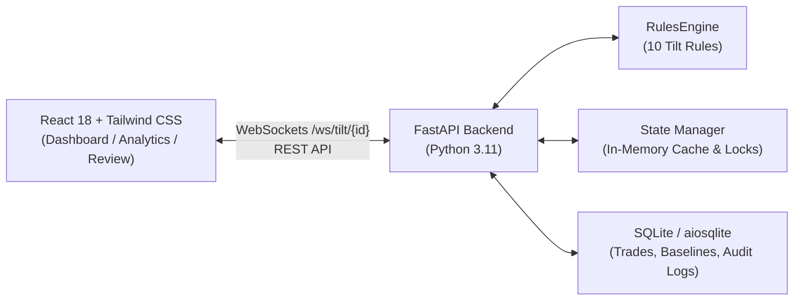

# AegisTilt — Kill Switch Intelligence Layer for Traders

> **Real-time Behavioral Monitoring & Revenge Trading Prevention System**

AegisTilt is an intelligence layer designed for active day traders and prop firm desks to intercept emotional escalation and revenge trading before catastrophic drawdown occurs. It continuously monitors trader execution behavior against statistical baselines and enforces graduated intervention levels.

---

## ⚡ Key Features

- **Real-Time Tilt Scoring Engine (0–100 pts)**: Evaluates 10 behavioral and mathematical trading rules on every trade execution.
- **Graduated Interventions**:
  - `0–30 (Green)`: Normal monitoring, optimal psychological state.
  - `31–60 (Yellow)`: Emotional velocity nudge & dashboard warning.
  - `61–90 (Orange)`: **Soft Lock** — Enforces mandatory 60-second cooldown timer or explicit typing of `"I confirm this trade"`.
  - `90+ (Red)`: **Hard Kill Switch** — Halts execution completely, locks session for a 30-minute mandatory break, requires documented thesis reason to override.
- **Sub-Millisecond In-Memory State**: Fast tilt score evaluation with SQLite persistent audit trail.
- **Bi-Directional WebSockets**: Broadcasts tilt score updates, triggered rules, and lock events in real time.
- **Unified Multi-Broker Integrations Layer**:
  - Connects to top Indian brokers: **Dhan (Primary)**, **Upstox (with Sandbox)**, **Zerodha Kite**, **Fyers**, **Angel One (SmartAPI + TOTP)**, and **ICICI Breeze**.
  - All brokers implement the identical abstract `BrokerAdapter` interface.
  - Intercepts order placement at the gateway: blocks orders when in the Hard Kill Switch zone.
  - Automatically cancels open orders and can square off open positions when the Hard Lock triggers.
  - Credentials encrypted with AES-128-CBC via Fernet.
- **Interactive Dashboard**:
  - Radial animated SVG Tilt Gauge with live needle and color zones.
  - Trade Form with **1-Click Test Scenarios** (Revenge Re-entry, Size Escalation, FOMO Chase, Boredom Trade, etc.).
  - Real-Time Tilt Event Stream with points badges and rule metadata.
  - Active Session Telemetry & PnL tracking.
- **Analytics & Pattern Heatmap**:
  - Interactive Tilt Score timeline chart.
  - Rule trigger frequency breakdown.
  - Revenge trade detection history.
  - 24-Hour Intraday Heatmap pinpointing high-risk execution hours.
- **Post-Session Review**:
  - Quantifies preventable PnL lost to revenge trades.
  - Catalogs all flagged emotional anomalies.
  - Provides customized psychological coaching directives.

---

## 📐 Architecture & Tech Stack



- **Backend**: Python 3.11, FastAPI, SQLAlchemy 2.0, aiosqlite, Pydantic V2, WebSockets
- **Frontend**: React 18, TypeScript, Tailwind CSS, Lucide Icons, Recharts, Vite
- **Storage**: SQLite (zero-config local persistence), in-memory fast caching layer

---

## 📏 Tilt Scoring Rules Engine (10 Rules)

| # | Rule Identifier | Condition | Points | Description |
|---|---|---|---|---|
| 1 | `LOSS_OCCURRED` | `trade.pnl < 0` | **+10** | Any realized loss incurs initial baseline tilt friction |
| 2 | `REVENGE_REENTRY` | Loss + new trade < 3 min on same instrument | **+20** | Immediate re-entry attempt driven by impulsive retaliation |
| 3 | `CONSECUTIVE_LOSS` | 3+ losses in a row | **+15 per loss** | Streak penalty compounding emotional desperation |
| 4 | `SIZE_ESCALATION` | `position_size > 1.5x baseline` after loss | **+20** | Martingale impulse sizing to win back losses |
| 5 | `SAME_TICKER_FIXATION` | 3+ trades on same instrument in 30 min | **+15** | Hyper-focusing on an erratic instrument |
| 6 | `OUTSIDE_SESSION` | Trade outside defined active session hours | **+25** | Breaching discipline by trading off-hours/illiquid markets |
| 7 | `FREQUENCY_SPIKE` | Trades/hour > 2x hourly baseline | **+15** | Over-trading frenzy exceeding normal execution cadence |
| 8 | `FOMO_CHASE` | Entry after move already 70%+ extended on ATR | **+10** | Entering parabolic moves near exhaustion points |
| 9 | `OVERCONFIDENCE` | Position size 2x+ after 3 consecutive wins | **+10** | Euphorically bloating size after a winning streak |
| 10 | `BOREDOM_TRADE` | Low ATR (&le;0.6) + No defined setup (`CHOP` / `NONE`) | **+10** | Taking impulsive trades in low-volatility dead markets |

### Auto-Reset & Cooldowns
- **Manual Reset**: Trader can reset score to 0 with a logged rationale.
- **Auto Reset**: 4-hour cooldown period with score &lt; 30 resets score to 0.
- **Session Reset**: Initiating a new trading session resets active score.
- **Overrides**: Overriding a Hard Lock reduces score to 60 (Yellow) and logs an immutable record with trader thesis.

---

## 🚀 Quick Start Guide

### 1. Prerequisites
- Python 3.11+
- Node.js 18+ and npm

### 2. Run with One Command
```bash
./start.sh
```

Or start manually:

**Backend:**
```bash
python3.11 -m venv backend/venv
backend/venv/bin/pip install -r backend/requirements.txt
PYTHONPATH=. backend/venv/bin/uvicorn backend.app.main:app --host 127.0.0.1 --port 8000 --reload
```

**Frontend:**
```bash
cd frontend
npm install
npm run dev
```

### 3. Open in Browser
- **Frontend Dashboard**: [http://localhost:5173](http://localhost:5173)
- **Interactive Swagger API Docs**: [http://127.0.0.1:8000/docs](http://127.0.0.1:8000/docs)
- **WebSocket Endpoint**: `ws://127.0.0.1:8000/ws/tilt/trader_alpha`

---

## 🔌 Unified Broker Integrations Layer

AegisTilt abstracts broker interactions through a single, consistent `BrokerAdapter` interface:

```python
class BrokerAdapter(ABC):
    @abstractmethod
    async def get_positions(self) -> list[Position]: ...
    @abstractmethod
    async def get_order_history(self, from_date=None, to_date=None) -> list[Order]: ...
    @abstractmethod
    async def get_trades(self, from_date=None, to_date=None) -> list[Trade]: ...
    @abstractmethod
    async def place_order(self, order: OrderRequest) -> OrderResponse: ...
    @abstractmethod
    async def cancel_order(self, order_id: str) -> bool: ...
    @abstractmethod
    async def block_trading(self) -> bool: ...  # Kill switch action
    @abstractmethod
    async def get_account_info(self) -> AccountInfo: ...
    @abstractmethod
    async def stream_order_updates(self) -> AsyncGenerator: ...  # Live WS feed
```

### Supported Brokers

| Priority | Broker | Auth Method | Capabilities & Notes |
|---|---|---|---|
| 1 | **Dhan (Primary)** | Client ID + Access Token | Native WebSocket order updates, `"kill-switch-blocked"` tagging, fallback pull |
| 2 | **Upstox** | OAuth2 Bearer Token | Dedicated Sandbox environment for prototype order simulation |
| 3 | **Zerodha Kite** | API Key + Access Token | OAuth daily login flow, KiteTicker trade events, token refresh endpoint |
| 4 | **Fyers** | App ID + Access Token | FyersDataSocket updates, native GTT conditional order handling |
| 5 | **Angel One** | API Key + Client Code + TOTP | Automated 2FA login with built-in `pyotp` TOTP code generation |
| 6 | **ICICI Breeze** | App Key + Secret + Session Token | SHA256 API verification with direct tradebook feeds |

### Kill Switch & Broker Action Enforcement

When the tilt score reaches **90+ (Hard Lock)**:
1. `BrokerManager` intercepts all outgoing `place_order` requests, rejecting them with `HTTP 423 Locked`.
2. Cancels all pending/open orders across the active broker (`Dhan`, `Upstox`, `Zerodha`, etc.).
3. Optionally squares off all open positions (if configured in settings).
4. Records all cancellations and actions in the `KillSwitchAction` audit ledger.
5. Emits an urgent `BROKER_KILL_SWITCH_EXECUTED` event over WebSocket.

---

## 🧪 Running Automated Tests

Run the full automated test suite (14 test cases covering all 10 rules, API contracts, lock challenges, and scenario lifecycles):

```bash
PYTHONPATH=. backend/venv/bin/pytest backend/tests -v
```

---

## 📡 API Endpoints

| Method | Path | Description |
|---|---|---|
| `POST` | `/api/trades` | Submit new trade, triggers rules engine, returns tilt updates |
| `GET` | `/api/trades/{trader_id}` | Fetch session trade history |
| `GET` | `/api/tilt-score/{trader_id}` | Current tilt score, status, and lock cooldowns |
| `GET` | `/api/tilt-events/{trader_id}` | Event history for the session |
| `POST` | `/api/kill-switch/override` | Trader override with documented reason (logged) |
| `POST` | `/api/kill-switch/reset` | Manual score reset with reason (logged) |
| `POST` | `/api/kill-switch/soft-unlock` | Soft lock confirmation verification |
| `GET` | `/api/analytics/{trader_id}` | Session timeline, rule breakdown, and heatmap data |
| `GET` | `/api/baseline/{trader_id}` | Trader baseline parameters |
| `POST` | `/api/baseline/{trader_id}` | Update baseline parameters (active hours, size, etc.) |
| `POST` | `/api/baseline/{trader_id}/recalculate` | Recalculate baseline from historical trades |
| `POST` | `/api/session/start` | Start trading session |
| `POST` | `/api/session/end` | End session and compute audit summary |
| `GET` | `/api/session/current/{trader_id}` | Fetch active session |
| `GET` | `/api/session/summary/{session_id}` | Fetch post-session review summary |
| `WS` | `/ws/tilt/{trader_id}` | Real-time WebSocket feed |
